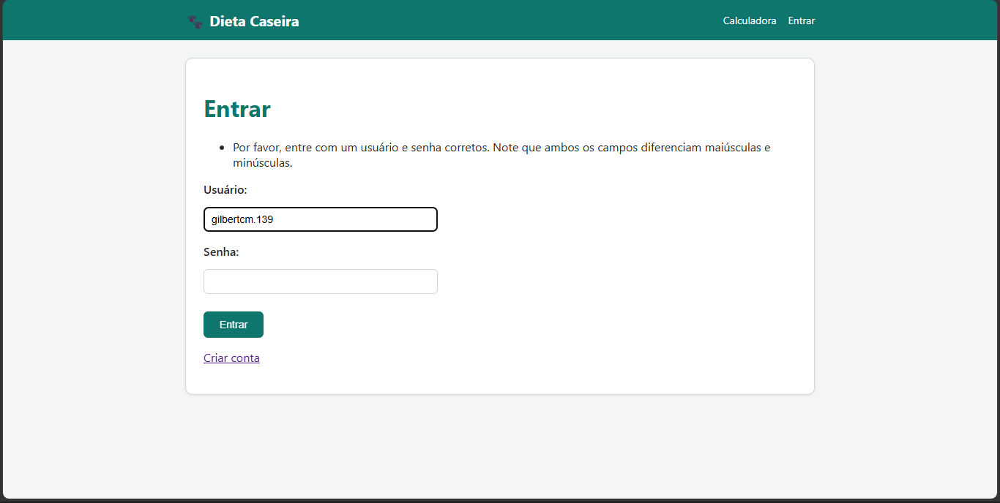
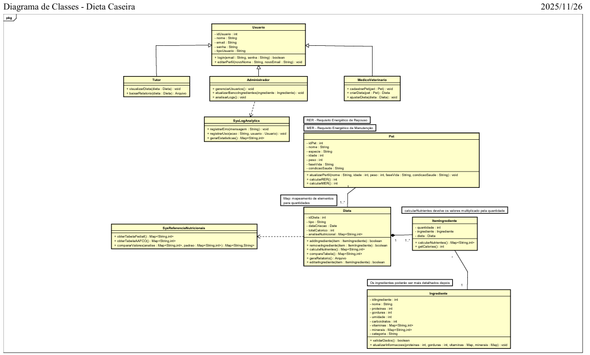
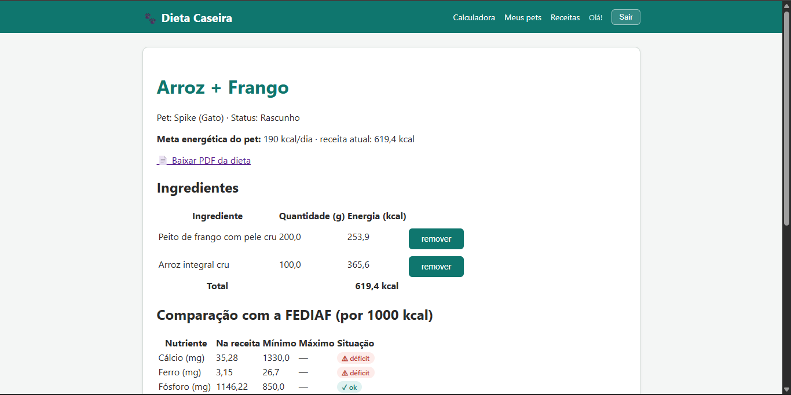
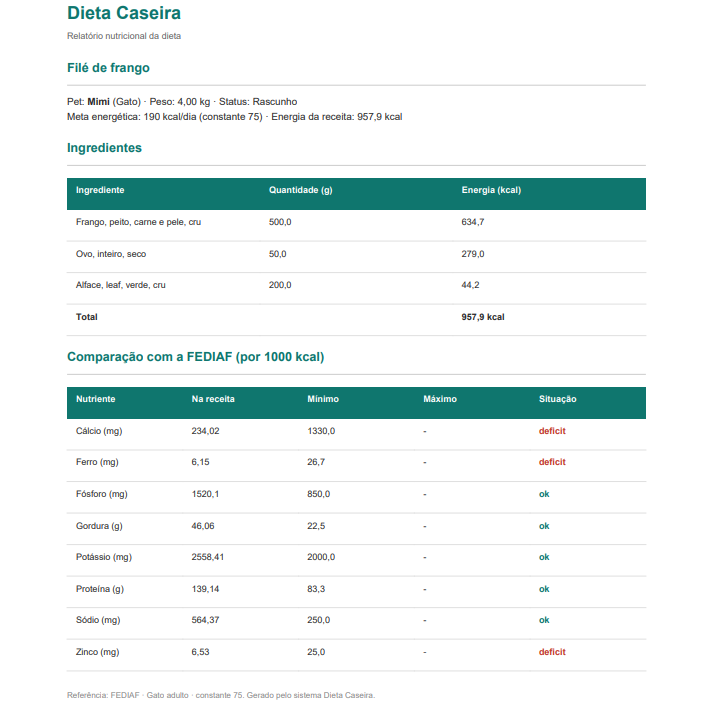
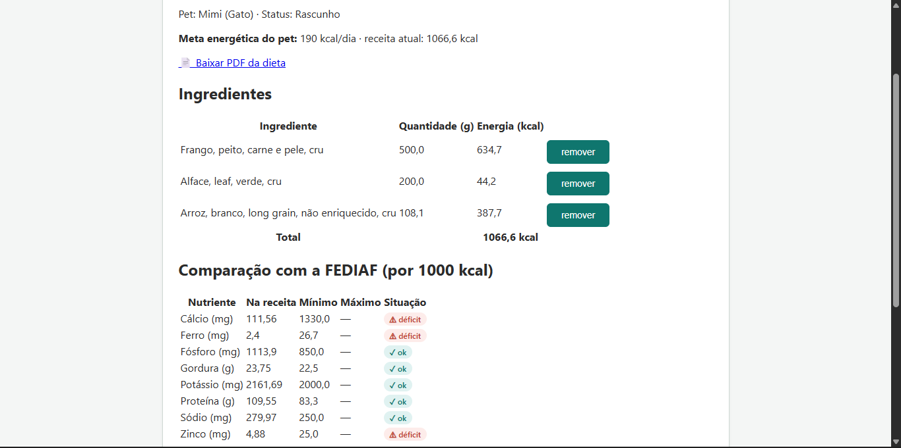
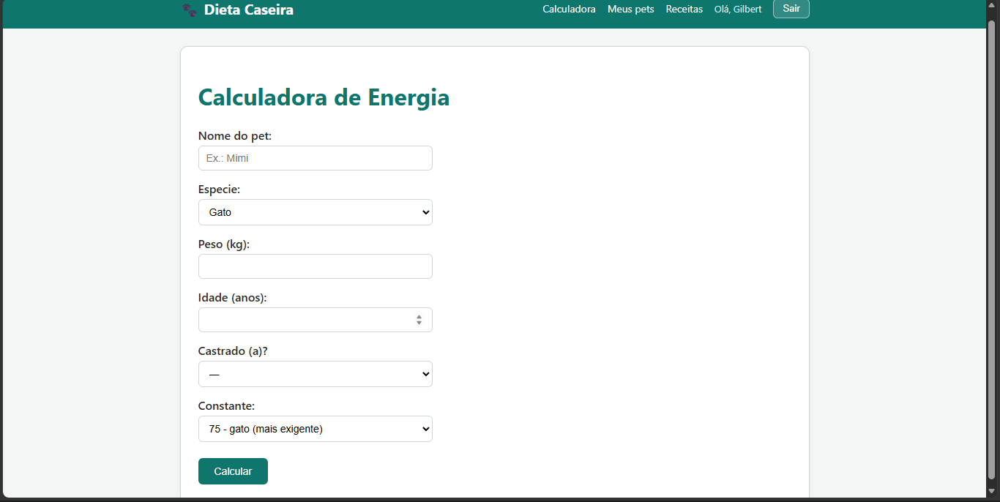

# 🐾 Dieta Caseira — Formulação Nutricional para Cães e Gatos

> Plataforma web em português para formular e analisar dietas caseiras de cães e gatos, desenvolvida para o ensino de Medicina Veterinária no Hospital Veterinário da UESC (HOSPVET).

**Instituição:** Hospital Veterinário da Universidade Estadual de Santa Cruz (UESC) · **Contexto:** estágio em engenharia de software · **Meu papel:** desenvolvedor, do levantamento de requisitos à implementação

> 🔒 **O código-fonte é privado**, porque pertence à instituição. Este repositório apresenta o projeto. Posso fazer uma demonstração técnica em entrevista.

---

## 🎯 O problema

As ferramentas internacionais de formulação de dietas, como o Balance It, liberam os recursos completos apenas para nutricionistas credenciados. Isso limita o uso em sala de aula pelos alunos de Medicina Veterinária, que precisam praticar a formulação e a análise nutricional.

## 💡 A solução

Uma plataforma própria, em português, onde a professora cadastra os ingredientes e aprova os usuários, e os alunos montam receitas, analisam os nutrientes e comparam o resultado com as diretrizes internacionais.

## ✨ Funcionalidades (MVP)

- Autenticação com aprovação de cadastro pela administradora
- Perfis de pet com cálculo da necessidade energética (RER/MER)
- Editor de receitas com análise nutricional por ingrediente
- Comparação com as diretrizes FEDIAF
- Relatório em PDF da formulação
- Telas administrativas para gestão de ingredientes e usuários

## 👥 Perfis de usuário

| Perfil                      | O que faz                                      |
| --------------------------- | ---------------------------------------------- |
| Administradora (professora) | Cadastra ingredientes e aprova usuários        |
| Aluno                       | Formula e analisa receitas, exporta relatórios |
| Tutor                       | Prevista para uma fase futura                  |

## 🛠️ Stack

| Camada              | Tecnologia                                                     |
| ------------------- | -------------------------------------------------------------- |
| Back-end            | Python · Django                                                |
| Banco de dados      | PostgreSQL                                                     |
| Front-end           | Templates Django · HTMX · Alpine.js                            |
| Relatórios          | WeasyPrint (PDF)                                               |
| Dados de referência | FoodData Central/USDA (Foundation Foods) · FEDIAF 2025 · AAFCO |

## 📐 Engenharia de requisitos

Antes de programar, o projeto foi planejado junto com a professora responsável:

- Documento de requisitos com **13 requisitos funcionais, 11 regras de negócio e 7 requisitos não funcionais**
- **7 casos de uso** documentados
- Diagrama de classes inicial
- Plano de desenvolvimento em fases

## 📸 Telas

Adicione 2 ou 3 prints com dados de teste, o tradutor do navegador desligado e sem a barra de endereço:
| Análise nutricional | Relatório em PDF |
|---|---|
|  |  |
|  | |
|  | |

## 🚧 Status

Em desenvolvimento: Fase 2 (MVP).

## 📚 O que aprendi

Neste processo de desenvolvimento do sistema de dieta caseira, obtive amplos conhecimentos na implementação em python e django sob um cenário com pouco conhecimento, desafiando minha curiosidade neste desáfio para minha carreira.

---

**Gilbert C. Macêdo** · Desenvolvedor Back-end Python | Django
[LinkedIn](#) · [Portfólio](#) · gilbertcm139@gmail.com
